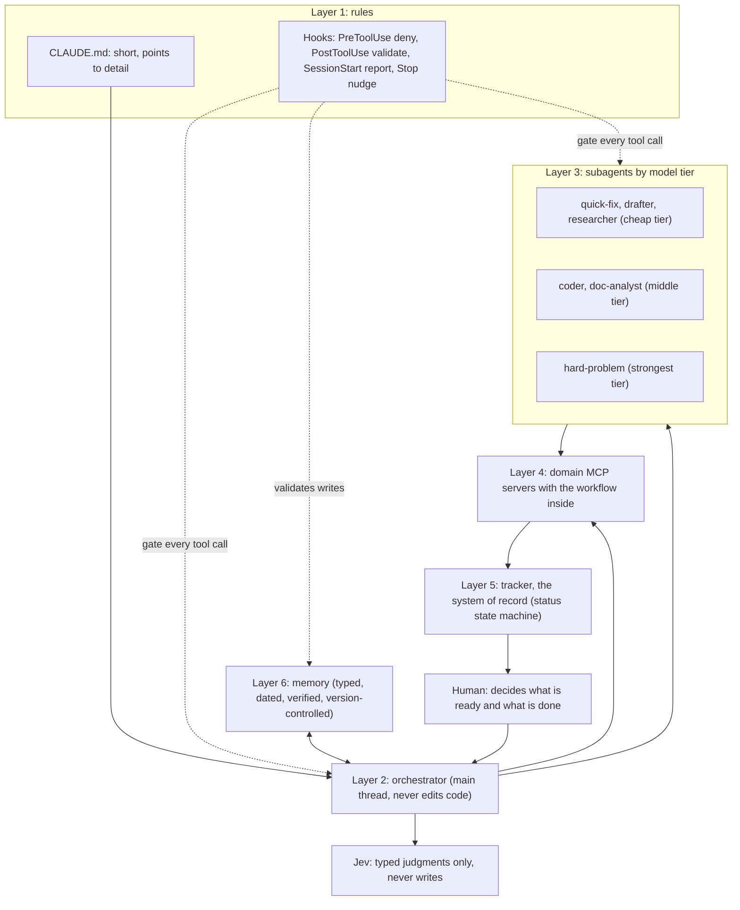

# Claude Code, run like a small engineering team

Most people use Claude Code as a smarter autocomplete: open a session, describe a
problem, accept what it does, repeat. That leaves most of the value on the table.
This repository documents the setup I use instead. It treats Claude Code as a small
engineering team with guardrails: rules are enforced by hooks rather than hoped for
in prose, a tracker with a state machine decides what is ready and what is done, the
main session orchestrates while cheaper subagents do the work, a cheap decision model
handles judgments, memory is a typed and dated knowledge base, and every domain I
work in gets its own MCP server with the rules built in.

Author: Anthony Araujo, a programmer of 45 years.

In the 60 days to 2026-10-21 this setup closed 1,160 issues across 15 projects, with
about 3,590 hours of estimated skilled-developer effort logged against them. That is
an effort estimate, not a stopwatch reading (see
[the issue workflow](docs/04-issue-workflow.md) for what the number means). The point
is not the number. The point is that I spent that time deciding what was ready, what
was done, and which tradeoff to take, and very little of it supervising keystrokes.

## The shape of it

## Contents

| Doc | What it covers |
|---|---|
| [01 Philosophy](docs/01-philosophy.md) | What most people get wrong, and the principles behind everything else |
| [02 Architecture](docs/02-architecture.md) | The layers and how a request moves through them |
| [03 Hooks](docs/03-hooks.md) | Rules that live in code: every hook class, with the JSON and real deny messages |
| [04 Issue workflow](docs/04-issue-workflow.md) | A self-hosted tracker as system of record, and the status state machine |
| [05 Agents and model routing](docs/05-agents-and-model-routing.md) | Orchestrator plus tiered subagents, and delegate helpers from other vendors |
| [06 Jev decision model](docs/06-jev-decision-model.md) | A cheap typed-judgment model under the agents, with measured numbers and the break-even trap |
| [07 Skills](docs/07-skills.md) | Repeated workflows turned into single commands |
| [08 Memory](docs/08-memory.md) | Memory as a structured knowledge base, with a full example file |
| [09 MCP servers](docs/09-mcp-servers.md) | Writing domain servers, the `help()` pattern, and a minimal skeleton |
| [10 Infrastructure rules](docs/10-infrastructure-rules.md) | Standing rules for anything new that comes into existence |
| [11 Verification](docs/11-verification.md) | Verify, do not assert |
| [12 Walkthrough](docs/12-walkthrough.md) | One fictional project, idea to closed issue, with the tool calls |
| [13 Getting started](docs/13-getting-started.md) | How to adopt this incrementally |
| [Glossary](docs/glossary.md) | Terms used across the docs |

Working files you can copy live in [examples/](examples/README.md): hooks with tests,
a sample settings file, a CLAUDE.md, agent definitions, skills, a commit-msg hook and
a sample memory bundle.

## Start here

You do not need all of this. The first week is three hooks and a short CLAUDE.md:
read [Getting started](docs/13-getting-started.md), copy the three hooks from
[examples/hooks/](examples/hooks/), and add the sample
[settings](examples/settings/settings.example.json). Subagents, a tracker and memory
each come later, and each pays for itself independently.

If you read only one doc first, read [Hooks](docs/03-hooks.md). Moving a rule from
prose into a hook is the single change that matters most.

## A caution about what this is

This is a description of one person's workflow, published so you can steal parts of
it. Paths, tool names and thresholds are mine; change them. The hooks are drift
guards, not a security boundary: they stop an agent from forgetting a rule, not a
determined attacker from bypassing one. Treat them accordingly.

## License

MIT. See [LICENSE](LICENSE).
