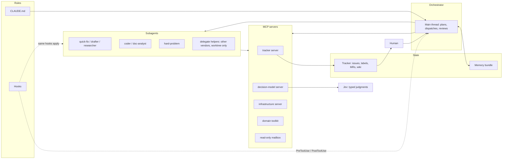

# 02. Architecture

The setup is a stack of layers. Each layer has one job, and each is useful without
the ones above it.

## Layer 1: rules (CLAUDE.md and hooks)

`CLAUDE.md` is deliberately short. It holds the hard rules (a dozen lines), pointers to
detail, and conventions that cannot be checked mechanically. Anything that *can* be
checked mechanically is a hook instead. The split is the point: prose for judgment,
code for rules. See [Hooks](03-hooks.md).

A rule has four possible homes, in increasing strength:

1. A line in `CLAUDE.md`. Weakest; drifts over a long session.
2. A memory entry. Loaded each session; still advisory.
3. A hook returning `ask`. A human confirms each time.
4. A hook returning `deny`. The call does not happen.

Pick the weakest one that actually holds.

## Layer 2: the orchestrator

The main thread plans and dispatches. It does not edit code; a hook denies the edit
and names the agent to dispatch to instead. This sounds pedantic and is the most
effective cost control in the setup: the main thread's context is the most expensive
thing in the system, because it is re-sent on every request. See
[Agents and model routing](05-agents-and-model-routing.md).

## Layer 3: subagents

Cheap and fast for drafting, searching and trivial edits. Mid-tier for implementation
from a clear spec and for reading documentation. The strongest model for bugs that
resisted several attempts and for real architecture tradeoffs. Each agent is a small
markdown file: a name, a model, an optional tool allowlist, and a prompt that states
its contract and its report format.

Separately, *delegate helpers* run other vendors' coding agents headless in a
disposable git worktree. They are a second opinion, never an authority, and they never
write to the real repository.

## Layer 4: MCP servers

Each domain gets its own server, and the workflow rules live inside the tools. The
tracker server refuses illegal status moves; the mailbox server has no send verb; the
infrastructure server can read a VM's installer screen and wait for boot. Every server
has a `help()` tool serving as its catalogue. See [MCP servers](09-mcp-servers.md).

One server is special: the decision-model server wraps Jev, a model that only returns
typed judgments. The orchestrator hands it a pile of items and gets back a compact
table, with the item contents never entering the conversation. See
[Jev decision model](06-jev-decision-model.md).

## Layer 5: state

Two stores outlive a session.

**The tracker** is the system of record for work: what exists, what is ready, what is
in flight, what is done, how much effort it took. It is a self-hosted GitLab, reached
only through the MCP server. See [Issue workflow](04-issue-workflow.md).

**Memory** is the system of record for knowledge: who I am, how I want things done,
the state of each project, reference facts, and traps. It is a folder of small typed
files, validated by a hook and kept in version control. See [Memory](08-memory.md).

The separation matters. Work state lives in the tracker, where a human can see and
change it. Knowledge lives in memory, where it is dated and can be marked stale. Do not
store one in the other.

## How a request moves through the stack

1. I describe what I want. The orchestrator reads memory for context and the tracker
   for current state.
2. If it is new work, the orchestrator files an issue. Unmade decisions become
   written questions on the issue at write time, not later.
3. I promote the issue to `ready` after it passes the definition-of-ready gate.
4. A skill dispatches one subagent per ready issue, each in its own worktree. The
   agent takes the dispatch lock, implements, and opens a merge request.
5. Every tool call the agent makes passes through the hooks.
6. The agent hands the issue back to `review` with the merge request open, and stops.
7. I read the merge request and say close. A single tool call runs the whole closing
   protocol.
8. Any new trap discovered along the way goes into memory.

At no point does the model decide that something is done.

## Where each concern lives

| Concern | Where it lives |
|---|---|
| Never delete, never heredoc, never `cd && git` | PreToolUse hooks |
| Work systems need an explicit OK | PreToolUse hook (ask) |
| Work content never reaches other vendors | PreToolUse hook (deny, no override) |
| Main thread does not edit code | PreToolUse hook on edit tools |
| Illegal status moves | The tracker MCP server |
| Closing protocol | One tool call in the tracker server |
| Closing keywords in commits | A global commit-msg git hook |
| Which model does which job | Agent definitions plus `CLAUDE.md` routing note |
| Cheap classification | Jev, via its MCP server |
| What is stale | `stale_after` in memory, reported at SessionStart |
| What is true about infrastructure | The inventory, proven by a real command |

Next: [03 Hooks](03-hooks.md)
