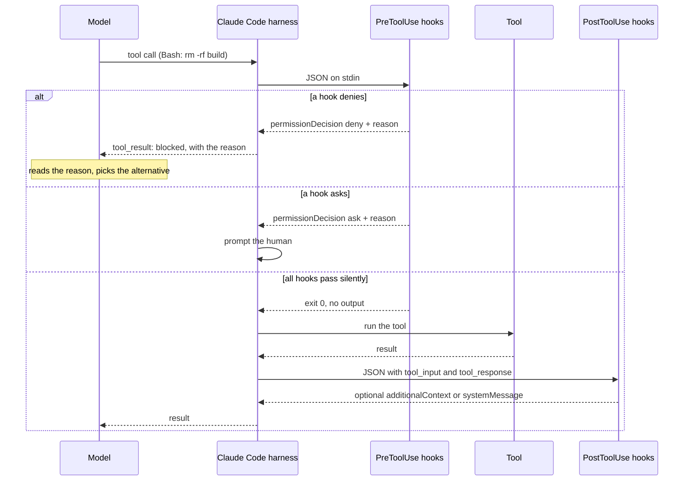

# 03. Hooks: rules live in code, not prose

If I have corrected the same behaviour twice, it becomes a hook. This doc goes through
each class of hook I run, what it catches, and what the model sees when it is stopped.

Working copies, with tests, are in [examples/hooks/](../examples/hooks/). The wiring is
in [examples/settings/settings.example.json](../examples/settings/settings.example.json).

## How a hook sees a tool call

Claude Code runs your command at defined points and hands it JSON on stdin. The ones I
use:

| Event | When | What I use it for |
|---|---|---|
| `PreToolUse` | Before a tool runs | Deny or ask; the workhorse |
| `PostToolUse` | After a tool succeeds | Validate what was written, record state |
| `UserPromptSubmit` | When I send a message | Detect phrases like "do it yourself" |
| `SessionStart` | New session | Report stale memory |
| `Stop` | The model finishes a turn | Nudge it to record outcomes |



### What a hook receives

```json
{
  "session_id": "5d1c0f1e-0000-0000-0000-000000000000",
  "cwd": "/home/me/projects/acme-widgets",
  "hook_event_name": "PreToolUse",
  "tool_name": "Bash",
  "tool_input": {
    "command": "cd /home/me/projects/acme-widgets && git status",
    "description": "Show working tree status"
  }
}
```

For `Edit` and `Write`, `tool_input` carries `file_path` and the content fields. For MCP
tools, `tool_name` is `mcp__<server>__<tool>`. A call made inside a subagent also
carries an `agent_id`, which the orchestrator-only hook uses to tell main-thread edits
from subagent edits. `PostToolUse` adds `tool_response`.

### What a hook returns

Silence and exit code 0 mean "no opinion". To decide, print:

```json
{
  "hookSpecificOutput": {
    "hookEventName": "PreToolUse",
    "permissionDecision": "deny",
    "permissionDecisionReason": "Blocked: ... what to do instead ..."
  }
}
```

`permissionDecision` is `allow`, `deny` or `ask`. The reason goes back to the model, so
write it as an instruction: what happened, why, and the exact alternative.

Two design rules I hold to:

- **Fail open on your own bugs.** A broken hook must not wedge every session. Wrap the
  logic, exit 0 on an unexpected exception, and log the error somewhere you will see it.
- **Judge commands, not strings.** A naive grep for `rm` blocks a commit message that
  mentions `rm`. My shell hooks parse the line into commands first (quotes handled,
  variables set earlier in the line substituted, `bash -c` bodies included), and judge
  each command word and its real arguments. The first version of every hook was a grep;
  every one of them got rewritten after a false positive or a bypass.

## The PreToolUse hooks

### No delete, archive instead

The first hook, and the one with the best return. A delete is irreversible; a move is
not. The hook splits the cases:

- **deny**: bulk or unrecoverable removal (recursive or forced flags, a glob,
  `find -delete`, `git clean -f`).
- **ask**: a plain single-target `rm`. A named one-off is exactly where confirming
  beats blocking.
- **allow**: `git rm` (history is the archive), scratchpad and temp directories,
  regenerable caches (`node_modules`, `__pycache__`), and agent worktrees.

```
Blocked: bulk or unrecoverable removal. The rule is archive, never delete: move it
aside instead -- mv <path> <dir>/_archive/ -- or, for a tracked file, use git rm so
history keeps the copy. Scratchpad, /tmp and regenerable caches (node_modules,
__pycache__, .pytest_cache) are exempt and need no workaround.
```

### Git through one wrapper

`cd repo && git status` defeats the permission allowlist: the allowlist matches on a
command prefix, and `cd <varying-dir> &&` never matches a stable one, so every call
becomes a prompt. A one-line wrapper (`git -C <dir> "$@"`) gives a stable prefix. The
hook denies a `cd` followed by `git` in the same line, and names the wrapper:

```
Blocked: `cd <dir> && git ...` defeats the permission allowlist, so it prompts every
time. Use the allowlisted wrapper instead -- `bash ~/tools/git-in.sh <repo-dir> <git
args...>` (it runs `git -C <dir> ...`, no cd). Example: bash ~/tools/git-in.sh
~/projects/acme-widgets status -s
```

Wrapper: [examples/scripts/git-in.sh](../examples/scripts/git-in.sh). Hook:
[examples/hooks/block-cd-git.sh](../examples/hooks/block-cd-git.sh).

### No heredocs for file content

Backslash escapes get mangled between the tool call and the shell. A patch carrying
`\n` silently fails to match, and the edit ends up done twice. The `Write` and `Edit`
tools have no such layer. The hook denies `<<EOF` heredocs (and PowerShell
here-strings), while allowing `<<<` and `1 << 2`.

```
Blocked: heredocs and PowerShell here-strings are banned for file content. Backslash
escapes get mangled in transit, so the patch silently fails to match and the edit ends
up being done twice. Use the Write tool for a whole file and the Edit tool for a
targeted change. Bash stays right for RUNNING things.
```

The hook script itself has to obey its own rule, so it emits its JSON with `printf`.

### No unbounded find

One `find / -name x` under a POSIX-on-Windows shell walked every drive and burned two
and a half hours of CPU before anyone noticed. The answer was two directories deep.
The hook denies `find` rooted at `/`, `~`, `$HOME` or a bare drive root without
`-maxdepth`.

```
Blocked: an unbounded `find` from a root directory walks the entire filesystem. Bound
it or root it: add `-maxdepth N`, or point find at the directory the file is actually
in.
```

The same class of mistake as a recursive `grep` over a directory full of disk images.
If it has hurt you once, it is a hook.

### No long sleep

Subagents waiting on a background job tend to write `sleep 590; grep ... log`. It
always costs the full ten minutes even when the job finished in forty seconds, and it
is blind to a crash meanwhile. The hook denies any single foreground sleep over 30
seconds and teaches the alternative: run the job in the background and act on the
completion notification, or poll a condition with a short sleep under a cap.

```
Blocked: a 590s foreground sleep used as a timer (limit 30s). Wait on the condition,
not the clock: (1) start the job with run_in_background=true and act on the completion
notification; (2) use the Monitor tool; or (3) poll with a short sleep under a cap,
e.g. timeout 590 bash -c 'until grep -q PATTERN FILE; do sleep 5; done'.
```

### Work-system write guard

I do contract work for a day job with its own ticketing, mail and repositories. The
rule is: reads are fine, writes need an explicit OK, every time. The hook enforces it
at two strengths:

- **deny**: anything touching the production instance of the ticketing system. No
  reads, no exceptions. The named trap is that URLs pasted from tickets point at
  production.
- **ask**: writes to the work repo host, to the work mail MCP, and file writes under
  the work directory. `ask` *is* the explicit OK, collected each time. A designated
  `_work` staging folder is exempt.

Reads pass untouched. Gating reads would break the tools rather than protect anything.
In your setup, replace "work systems" with whatever must never be changed on a whim:
production databases, a client's repository, a billing system.

[examples/hooks/block-work-systems.sh](../examples/hooks/block-work-systems.sh)

### Work content to third-party models (taint tracking)

Content from the day job may only be seen by Anthropic models. Other vendors' agents,
a decision model, and hosted app builders may log or train on what they receive. This
hook has two halves in one script, wired to both PreToolUse and PostToolUse on every
tool:

- **Taint.** If a session reads from a work MCP, touches a path under the work
  directory, or fetches a work host, the session is marked tainted (a file keyed by
  session id). Tool output that merely *mentions* a strong work identifier marks the
  session *suspect*, a weaker state, because tainting on every mention tainted most
  sessions that had nothing to do with work.
- **Gate.** Any route to a third-party AI is denied when the session is tainted, or when
  the request itself (the command line, or a task file it names) carries a work marker.
  A suspect session gets an `ask` instead.

There is **no override**. The guard's own CLI can clear a suspect flag, and the hook
refuses to let Claude run it: only the human clears their own guard.

```
Blocked: this session has touched work content, and this command routes to a
third-party AI. Work content goes to Anthropic models only (subagents: coder,
doc-analyst). No override.
```

A guard like this needs two properties to be worth having: it fails open on its own
bugs, and it announces the first taint to the human as a system message so a false
positive is visible rather than silently crippling the session.

[examples/hooks/block-work-to-third-party.py](../examples/hooks/block-work-to-third-party.py)

### Orchestrator-only: the main thread does not edit code

An edit tool call (`Edit`, `Write`, `MultiEdit`, `NotebookEdit`) made by the main thread
against a path under the code directories is denied. A call carrying an `agent_id` (made
inside a subagent) passes. Memory files, config, scratchpad and documents are main-thread
work and are allowed.

Two unlocks exist, both deliberate:

1. A dispatched agent recorded a `fail` or `partial` outcome in this session. The
   delegation was tried; the main thread may now step in.
2. I say "do it yourself". A `UserPromptSubmit` hook watches for a short list of phrases
   and drops an override marker for the session.

```
Main thread is orchestrator-only for code. Dispatch this edit of src/widget.py:
trivial (typo/rename/one-liner) -> quick-fix agent; specified feature/fix/tests ->
coder; resisted two attempts or hard design -> hard-problem. Unlocks: a dispatched
agent recorded fail/partial in this session, or the user says 'do it yourself'.
```

The first allowed-by-unlock edit per session is logged, so overrides stay visible.
[examples/hooks/orchestrator-only.py](../examples/hooks/orchestrator-only.py)

### Commit messages: a git hook, not a Claude hook

Closing keywords (`fixes #12`, `implementing #12`) auto-close issues on push and skip
the closing protocol. A global `commit-msg` git hook rejects them, and also rejects AI
co-author trailers. It lives in git, not Claude Code, because it should hold for me
typing a commit by hand too. [examples/git/commit-msg](../examples/git/commit-msg)

## PostToolUse: validate what was written

After a `Write` or `Edit`, a hook looks at whether the touched file is a memory file.
If so it checks the frontmatter, fills missing keys, rewrites wiki-style links into the
house link format, bumps a `generated` timestamp, appends to a change log, and
regenerates the index. If something is wrong it prints an error the model sees on the
next turn. This is how memory stays a clean bundle without anyone tidying it. See
[Memory](08-memory.md).

## SessionStart: report staleness

At session start, a hook reads every memory bundle, finds concepts whose `stale_after`
date has passed (or falls within a week), and injects a short report:

```
Memory freshness: 2 concept(s) need a re-check before you rely on them.
- STALE: Hypervisor firmware version (reference-hypervisor-firmware.md), stale_after 2026-10-01
- stale soon: Registry mirror address (reference-registry-mirror.md), stale_after 2026-10-24
Re-verify against the live system, then move stale_after forward. Add `verified`
only if the human confirmed it.
```

The instruction at the end is the point. Memory that can say "I may be out of date" is
worth far more than memory that cannot.

## Stop: nudge about outcomes

Every finished subagent is logged as `pending` by a SubagentStop hook, because only the
session that dispatched it can judge whether it did the job. A Stop hook blocks the
stop once, listing the pending rows and the command that records an outcome
(`success`, `partial`, `fail`). On the continuation it always lets the stop through, so
it cannot loop. Those outcomes feed the orchestrator-only unlock above, and over time
they show which agents earn their cost.

## How to add a hook

1. Notice the second correction. Not the first.
2. Write the hook as a small script that reads stdin JSON, decides, prints the JSON or
   nothing, and always exits 0.
3. Write the deny message as an instruction with the alternative named.
4. Add tests: one that must deny, one that must allow, one for the false positive that
   prompted the rewrite. [examples/hooks/tests/](../examples/hooks/tests/) has the shape.
5. Wire it in `settings.json` with the narrowest matcher that covers it.
6. Prefer `ask` over `deny` when a human judgment is the right gate.

These are drift guards. They stop an agent forgetting a rule. They are not a security
boundary against something actively trying to bypass them.

Next: [04 Issue workflow](04-issue-workflow.md)
