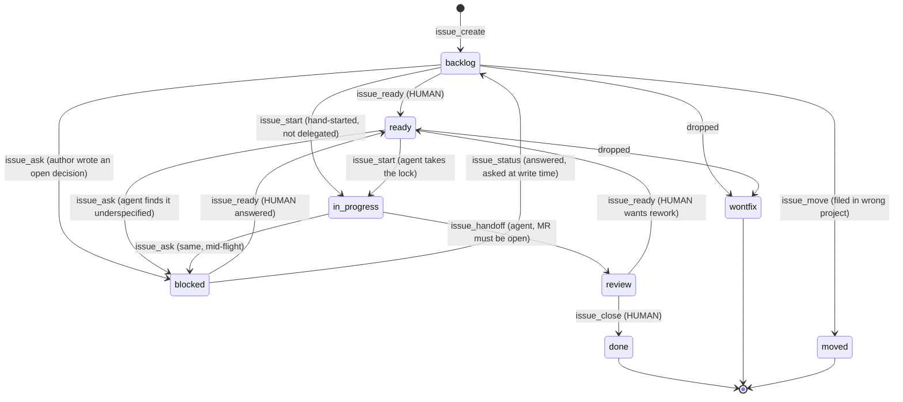

# 04. Issue workflow: the tracker decides, not the model

A self-hosted GitLab is the system of record for work. A model talking to it through
raw API calls would be free to do anything: close an issue it has not finished, skip
the time log, leave two status labels on one issue. So the model never talks to it
raw. It talks through an MCP server (roughly 90 tools) in which the workflow rules are
part of the tool surface, and the rules refuse the moves they forbid.

"Never hand-roll a REST call" is a rule, but a prose rule with a missing tool behind it
gets broken by necessity, not carelessness. The fix when a raw call was made because no
tool covered the case is to write the tool.

## Labels

Every issue carries exactly one `type::` label and one `status::` label. Priority is
optional.

- `type::` feature, bug, story, chore
- `status::` backlog, ready, in-progress, review, blocked, done, wontfix, moved
- `priority::` high, medium, low

On the free edition of GitLab, scoped labels are *not* mutually exclusive: adding
`status::review` does not remove `status::in-progress`. A hand-rolled label add leaves
two statuses on the issue. So status moves go through a tool that swaps atomically and
repairs an issue already carrying two. Creation enforces the rule too: a `type::` label
is required, `status::` defaults to backlog, and two of either is refused.

## The status state machine



The transition table, as the tool enforces it:

| From | To | Tool | Owner |
|---|---|---|---|
| backlog | ready | `issue_ready` | human |
| backlog | in-progress | `issue_start` | hand-started work, not delegated |
| backlog | blocked | `issue_ask` | the author wrote a decision it cannot make |
| ready | in-progress | `issue_start` | agent (takes the dispatch lock) |
| ready | blocked | `issue_ask` | agent found it underspecified |
| in-progress | blocked | `issue_ask` | agent, mid-flight |
| in-progress | review | `issue_handoff` | agent finished; needs an open MR |
| blocked | ready | `issue_ready` | human answered |
| blocked | backlog | `issue_status` | answered, and was asked at write time |
| review | ready | `issue_ready` | human wants rework |
| review | done | `issue_close` | human said close it |
| any | wontfix | | dropped |
| any | moved | `issue_move` | filed in the wrong project |

Every other move is refused, naming the legal moves and the tool that owns the state you
asked for. `ready -> done` was never worked. `backlog -> review` never happened.
`blocked -> in-progress` means the questions went unanswered.

**Every move into `ready` and the move into `done` belong to the human.** The three
moves an agent owns are `-> in-progress`, `-> blocked` and `-> review`. The two sets
never overlap: a human decides what is ready and what is done; an agent decides only
that it has started, that it is stuck, or that it is finished.

## What each status asserts

**`ready` is a promise that the issue is implementable cold**: by a session with no
conversation history, no memory of the conversation that filed it, and nobody to ask.
It authorises delegation. It is reached only through `issue_ready`, which *checks* the
claim and re-checks an issue someone flipped by hand, because a gate that cannot be
re-asked is decoration.

**`in-progress` is the dispatch lock.** An agent takes it before writing a line. An
issue wearing it is either a run in flight or a run that died, and nothing in the issue
tells those apart, so stranded issues are reported and never auto-picked-up.

**`blocked` means the issue carries a stated reason it cannot proceed.** Usually that is
unanswered questions written by `issue_ask`. A block with neither questions nor a typed
reason is refused. An issue blocked with nothing an answer could unblock is wrongly
blocked.

**`review` means a merge request is open**, not that a branch exists somewhere. A branch
nobody proposed has no diff to read and no place to leave a comment.

The distinction that matters most: *blocked is waiting on the human to answer; review is
waiting on the human to read.* Both look like "the agent stopped" from outside, and each
needs a different thing back.

## The definition of ready

`issue_ready` refuses an issue that:

- is a `type::story` (a decision, not delegable work);
- has an unanswered or contradictory question;
- states a decision as prose instead of asking it;
- has no acceptance-criteria section, or an empty one.

Passing the gate is necessary, not sufficient. The checks are structural, and an issue
can pass all four and still not say what to build. That residual gap is what the grooming
skill reads for, with a cheap model pre-sorting the borderline cases. See
[Skills](07-skills.md) and [Jev](06-jev-decision-model.md).

### Questions are asked, never guessed

Underspecified work stops. `issue_ask` writes the questions into the issue *description*
as checkboxes, not into a comment, because a checkbox can be ticked in the web UI and a
tick reads back as data. An answer buried in a thread has to be found and interpreted by
whoever reads next, and that does not survive a week.

```markdown
## Open questions

### Q1 - Should the poll interval be configurable per widget?
<!-- asked: 2026-08-19T12:00:00Z -->
- [ ] Yes
- [ ] No

### Q2 - What happens when a widget has no theme loaded?
<!-- asked: 2026-08-19T12:00:00Z -->
- [ ] Answered below
<!-- next: 3 -->
```

A yes/no is two boxes, not one. One box means "yes" when ticked and *either* "no" or "not
yet read" when clear, and those are the two answers a dispatcher must never confuse. Two
boxes make unanswered distinguishable from "no", and make a contradiction (both ticked)
visible instead of a coin flip.

The questions are written *when the issue is written*. The moment the author types "a
decision has to be made about X" is the moment X becomes an `issue_ask`. A decision-shaped
heading with no questions block is refused at create and update time, because the
ready gate reads the questions block and nothing else: a decision hiding under a heading
is invisible to it, passes, and ends up in front of an agent that builds something
nobody chose.

A decision that *has* been made is recorded with `issue_decide`, append-only, under a
heading the gate can see.

## The handoff carries the close

An agent never closes, so the close lands later, often days later, in a session that was
not there for the work. Everything the close needs must therefore be *on the issue* before
the working session ends. `issue_handoff` writes one structured comment and moves the
issue to `review` in the same call:

```markdown
## Handoff
<!-- handoff: v1 -->

- **repo:** `~/projects/acme-widgets`
- **branch:** `issue/42-retry-backoff`
- **commit:** `9e26896`
- **mr:** `17`
- **spend:** `3h`  <!-- proposed; issue_close logs it -->
- **summary:** exponential backoff for the sync client

### Verified
- [x] pytest: 214 passed

### Not verified
- [ ] the live round trip against staging
```

One comment per issue, updated in place. The proposed spend is never logged here:
time-logging is additive and the API offers no way to list prior entries, so a double log
cannot be detected afterwards. `issue_close` is the only tool that ever writes time.

## Closing is one call that runs a five-step protocol

`issue_close` does, in order, and stops at the first failure:

1. Cross-reference the merge request (and the commit) on the issue.
2. Log the spent time.
3. Move `status::` to a terminal value (`done`, or `wontfix` for dropped work).
4. Close the issue.
5. Sync the wiki from the repository's `docs/`.

`spend` and `repo` are required arguments, so the rules cannot be forgotten.
`spend='0'` is the explicit opt-out: a decision on the record, where a missing argument is
an oversight. Anything omitted is filled from the handoff comment, which is what makes
`issue_close(project, iid)` legal from a cold session.

Both of those strict choices come from one incident. An earlier shim for closing was a
bare state flip. It printed a success line for ten days while the written protocol around
it grew two more steps, and 21 issues lost their time log before anyone read the code.
The generalisable rule: a shim that reimplements rather than delegates will diverge, and
the divergence will be silent.

### Logged time is estimated skilled-developer effort

Not clock hours. Not wall time between messages. Not how long the session ran. Judge what
the change would reasonably cost a competent developer who knows the codebase, including
tests and docs, and log that. The numbers are then comparable across issues and useful
for planning. This is an honour-system rule: nothing can tell 90 minutes of judged effort
from 90 minutes of wall clock, and a checker that guessed would reject correct numbers.

That is the meaning behind the aggregate figure in the README: 1,160 closed issues and
about 3,590 hours of estimated effort over 60 days, across 15 projects.

## No closing keywords

Write `re #45`, never `closes #45`. GitLab's closing pattern is wider than people think:
`fixes`, `resolves` and `implementing` all auto-close on push, and `implementing #45`
reads as ordinary prose. An auto-close skips the protocol: no time log, no status move,
no wiki sync. Two doors are guarded: the global commit-msg git hook for commit messages,
and the merge-request create tool for MR titles and descriptions (their keywords fire on
*merge*, long after anyone is reading the words).

## Detection where prevention is impossible

A required argument cannot be required of a browser. Ten issues were once closed from the
web UI's bulk-edit panel still labelled backlog, with no time and no close note. The UI
door will not close, so there is a `close_audit` tool: closed issues on a non-terminal
status are the clean signal and reach the verdict; zero logged time is reported but never
blocked on, because most of that population is legitimate (dropped work, mirrored issues).
The repair is proposed, never applied.

## The loop in one paragraph

An issue is reviewed until it is implementable cold, dispatched to an agent that never
guesses and never closes, and handed back with everything the close will need written
down on it. See it run end to end in [the walkthrough](12-walkthrough.md).

Next: [05 Agents and model routing](05-agents-and-model-routing.md)
