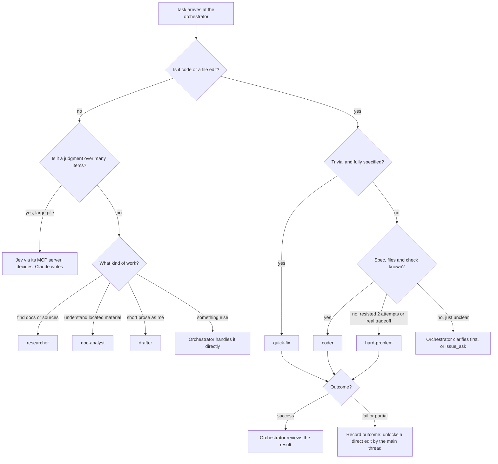

# 05. Agents and model routing

The main session does not edit code. It plans, dispatches, and reviews. Subagents do the
work, routed by how hard the work is.

## Why: context hygiene and cost

Every request in a session re-sends the whole conversation. A long session is
quadratic: the tenth issue worked in one conversation carries the diffs, test output and
dead ends of the first nine. A run of that shape once reached a context of about 635k
tokens and re-sent roughly 223 million tokens across 560 requests, with 46% of them in
turns above 500k.

Isolating each issue in its own subagent changes the shape from quadratic to linear. I
measured it on three real issues:

- A subagent starts cold at about 52.6k tokens (the fixed preamble and nothing else) and
  grows about 1.6k to 2.1k per request on its own work.
- Dispatching and collecting all three moved the parent conversation by about 24k tokens
  total, roughly 8k per issue, and none of that was the issues' diffs.
- Working the same three in one conversation added about 71.7k of *permanent* context per
  issue, which every later issue then re-sent on every request.
- The split breaks even at two issues. One issue is 0.81x (a lone agent pays a cold start
  the parent had already amortised), two is 1.11x, three 1.41x, eight 2.92x.

So routing is partly about money (a cheap model for a cheap job) and partly about
keeping the one expensive, long-lived context small.

## The tiers

| Tier | Agent | Use for | Tools |
|---|---|---|---|
| Cheap and fast | `quick-fix` | A trivial, fully specified edit: typo, rename, one-line config, version bump | all |
| Cheap and fast | `drafter` | Short prose written as me: status updates, issue comments, closure notes. Returns a draft, never sends | read-only |
| Cheap and fast | `researcher` | Find docs and primary sources; extract the passages that answer the question | search, fetch, read |
| Middle | `coder` | Implement a well-specified task: the spec, the files and the verification command are known | all |
| Middle | `doc-analyst` | Read material already located and work out what it means; cites sources, separates inference from fact | read-only |
| Strongest | `hard-problem` | A bug several attempts have not cracked, a real architecture tradeoff, a subtle correctness review | all |
| Below all of them | Jev | Typed judgments over large piles. Cannot write prose at all | via MCP |

Each agent is a markdown file with frontmatter and a short contract. The full set is in
[examples/agents/](../examples/agents/). They are short on purpose. The shape worth
copying:

```markdown
---
name: coder
description: Implements a well-specified coding task when the spec, files and
  verification command are already known. Route ambiguous design to hard-problem.
model: sonnet
---

You implement a task someone else has already specified. The spec is the contract:
do what it says, no more.

- Read the files involved before changing them; match the surrounding style.
- Make the smallest change that meets the spec. No drive-by refactors.
- Verify with the command you were given. Do not report success without running it.
- If the spec is wrong, ambiguous, or contradicts the code, stop and report that.
- Commit only if told to; never push, merge or close issues.

Report: what changed (files and why), the verification and its result, and anything
you were unsure about.
```

Three habits are in every agent prompt, because they are where delegated work goes
wrong:

1. **Stop and report when the spec is wrong.** Not "improvise a bigger fix".
2. **Do not claim success without running the check.**
3. **Report format is fixed**, so the orchestrator reads a few lines rather than a
   transcript.

The `description` field matters more than it looks. It is what the orchestrator reads to
decide whether to dispatch, so it should say when *not* to use the agent as well.

## The dispatch decision



The escalation path is explicit: an agent that fails twice is the signal for the
stronger tier, not for retrying the same prompt a third time. And a recorded failure is
what unlocks the orchestrator-only hook for a direct edit. See [Hooks](03-hooks.md).

### Work content stays on Anthropic models

For contract work for an employer, the routing has one more rule, enforced by a hook with
no override: that content goes only to Claude subagents. Not to other vendors' agents, not
to Jev, not to hosted app builders. The mid-tier agents (`coder`, `doc-analyst`) are the
destination for work tasks precisely because they are Claude. See
[Hooks](03-hooks.md#work-content-to-third-party-models-taint-tracking).

## Delegate helpers: other vendors' agents as a second opinion

Sometimes I want an independent view: a second review of a diff before a merge request,
or two independent attempts at a hard bug, compared. For that, a `delegate` skill runs
another vendor's coding agent (command-line agents from other labs, and any model behind
an OpenAI-compatible endpoint driven by one of them) *headless in a disposable git
worktree*, then Claude reviews what came back.

The standing rules:

1. **Claude stays the reviewer.** A helper's diff is a proposal. Read every line before
   applying it, run the repo's own checks after, and say what you rejected and why.
2. **A helper works only in its worktree.** Never pointed at the real checkout, never
   allowed to commit, push or merge. For helpers that run with all permissions and no
   sandbox, the worktree is the only fence, so keep their tasks to code work.
3. **Everything sent to a helper leaves the machine.** Personal code is fine. Work content
   is denied by the taint hook. Never put credentials in a task.
4. **Write the task cold.** The helper knows nothing about the conversation: name the
   files, the goal, the constraints, and how to verify.
5. **Watch the free budgets.** Free tiers have daily request caps. Use one helper for
   iterative work, another for a second opinion or a very large context.
6. **Report a usage line every turn a helper ran**, in tokens: calls and input/output
   tokens, since these run on subscriptions or free tiers.

An optional **acceptance gate** lets Jev judge each turn's diff against the issue's
acceptance criteria, one yes/no per criterion. It never applies, discards or blocks
anything. It is a sorting aid for the reviewer, not a verdict. Measured 16 of 16 on my own
ground truth.

Good uses: a second-opinion review of your own diff, independent attempts at a hard
bug, bulk mechanical edits that follow a pattern, a read-the-whole-repo question. Poor
use: a small edit you could make faster yourself, because writing the task and reviewing
the diff costs more than the edit.

## Tracking outcomes

A SubagentStop hook logs every finished subagent as pending. A Stop hook then asks the
dispatching session to record an outcome for each (`success`, `partial`, `fail`). Over a
few weeks that table answers the question "is this agent earning its cost?" with data,
and it feeds the unlock for direct edits.

Next: [06 Jev decision model](06-jev-decision-model.md)
