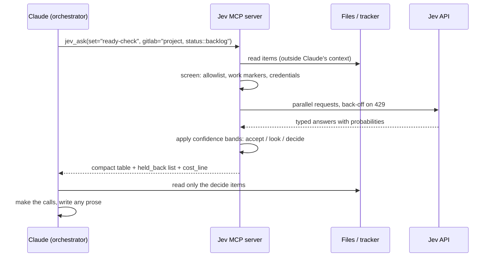

# 06. Jev: a cheap decision model under the agents

Much of the work in this setup is not writing, it is judging. Is this issue ready? Is
this log line mine or the game's? Is this alert noise? Does this merge request
description match its diff? Sending each of those through the strongest model is
expensive and fills the context. So there is a tier below the cheapest agent.

Jev is TypeSafe's "System One" model. It only returns typed judgments: pick one option,
score on a scale, or give a yes/no probability. It cannot write prose at all.

The standing rule is **Jev decides, Claude writes.** When Jev is unsure, Claude makes
the call.

## The MCP wrapper: contents never enter Claude's context

I wrote an MCP server around it. The key design choice is in what `jev_ask` accepts and
what it returns.

It accepts questions (or the name of a saved question set) plus *where the items are*:
file paths, globs, or a GitLab query. It does not accept the items' text. The server
reads the files itself and:

1. **Screens** each item (allowlisted roots, work markers, credentials, binary files).
2. **Sends** the survivors in parallel with back-off on rate limits.
3. **Returns a compact table**: each item marked `accept`, `look` or `decide`, with
   totals and a cost line.

Claude reads only the items marked `decide`. The file contents never entered the
conversation, which is both the cost saving and a privacy property.



## Saved question sets with re-measured bands

A question set is a named, saved list of typed questions. The confidence bands that
turn a probability into `accept` / `look` / `decide` are tuned per question against
real outcomes. This matters. The generic 0.8 / 0.2 thresholds left 80% of a backlog in
the borderline zone, which defeats the purpose. Re-measured bands (0.6 / 0.3 for the
readiness question) fixed that. The rule: measure the bands per question; do not assume
the defaults.

## Where it is embedded

Not just called by hand. It is wired into other tools:

- **The tracker's ready gate** can run a Jev check on whether an issue still contains an
  unmade decision, for example one hidden inline as "do A (or B)". Advisory only, and
  opt-in per project via a project attribute. A rule I hold to: whenever a new project is
  created, ask whether to turn the check on.
- **Backlog grooming** pre-sorts issues so the expensive model reads only the borderline
  ones. Jev's score is set beside the gate's own verdict, and every disagreement is read.
  The pre-sort decides what gets read, never what gets promoted.
- **An audit skill** reports closed issues that do not meet their acceptance criteria,
  `type::` labels that have drifted, and commits whose diff does not match the issue they
  cite. It reports only and never writes to the tracker.
- **The delegate acceptance gate** (see [Agents](05-agents-and-model-routing.md)).
- Smaller uses: triaging homelab alert noise, classifying the origin of game log lines,
  and finding duplicate memory files.

## Measured accuracy against my own ground truth

| Job | Result |
|---|---|
| Delegate acceptance gate | 16 of 16 |
| Backlog pre-sort vs the ready gate | 92 of 97, at re-measured bands |
| Memory dedupe | 18 of 18 |
| MR description vs diff | 6 of 6 |
| Game log origin | 11 of 13, every answer at confidence 0.5 or above right |
| Homelab alert noise | 2 of 2 |

Small samples; treat them as "it works well enough to be a pre-filter", not as a
benchmark.

## The per-turn cost line

Any turn that calls Jev ends with a cost line: calls, input tokens, USD. The API returns
tokens, not dollars, so the dollar figure is computed from the current per-token price.

```
Jev: 3 calls, 1,702 input tokens, $0.0000715
```

Show real digits, not rounded to $0.00. The line exists so the cost is a visible data
point rather than a belief, and if a call failed and returned no usage, the line says so.

## The trap I measured: a cheap model does not automatically save tokens

Each extra round trip resends 60k to 75k tokens of context to the orchestrator. On a
14-issue backlog, the Jev run took 5 requests and about 376k Opus-tier tokens; the
orchestrator reading the 14 issues itself took 3 requests and about 227k. The bodies
were only about 7k tokens. Each extra round trip (loading the tool, staging a file,
cleaning it up) cost far more than the bodies did.

Fitting a line through a 14-issue and a 150-issue run puts the break-even at about 45 to
60 issues, or roughly 15 to 20k tokens of bodies. Above that the gap widens by about 3k
orchestrator tokens per issue. A third point, with the tracker as a direct source so no
staging round trips were needed, 267 closed issues and about 1 MB of text:

| | Orchestrator requests | Orchestrator tokens |
|---|---|---|
| With Jev (orchestrator read only the 52 borderline issues) | 13 | about 1.7M |
| Orchestrator reading everything | 31 | about 9.5M |

That is 5.7x fewer raw tokens and about 4x cost-weighted. Jev's own bill for that run was
223 calls for $0.014. The verdicts agreed on 208 of 223; Jev was the stricter of the two
and never passed something the orchestrator failed.

The practical rule: **below roughly 50 items, just read them.** Use the classifier when
the pile is large relative to per-turn overhead, or when the content must stay out of
the context for its own sake.

## The safety lesson: anything sent to Jev leaves the machine

My first bulk run sent a memory file that contained a LAN login. The screen for client
content did not catch it, because it was looking for client markers, not secrets. The
fix, in order:

1. **Every item goes through a credential screen as well**, not only the work-marker
   screen.
2. **Work content is blocked outright**, enforced by the taint hook and by the server's
   own denied-roots list.
3. **List what was held back; never drop it silently.** On one 267-issue run the screen
   withheld 16% of the items, and the tool listed them. A real groom still has to read
   those by hand.

The general lesson: a screen designed for one kind of sensitive content gives false
confidence about another. When a tool sends local text to a third party, ask what the
worst thing in that pile could be, not what you expect to be in it.

## When to use it

Use it when the pile is large, the question has a closed answer set, and a wrong lean is
cheap because a human or a stronger model reads the borderline items. Do not use it to
generate text, to decide anything irreversible, or for a small pile.

Next: [07 Skills](07-skills.md)
