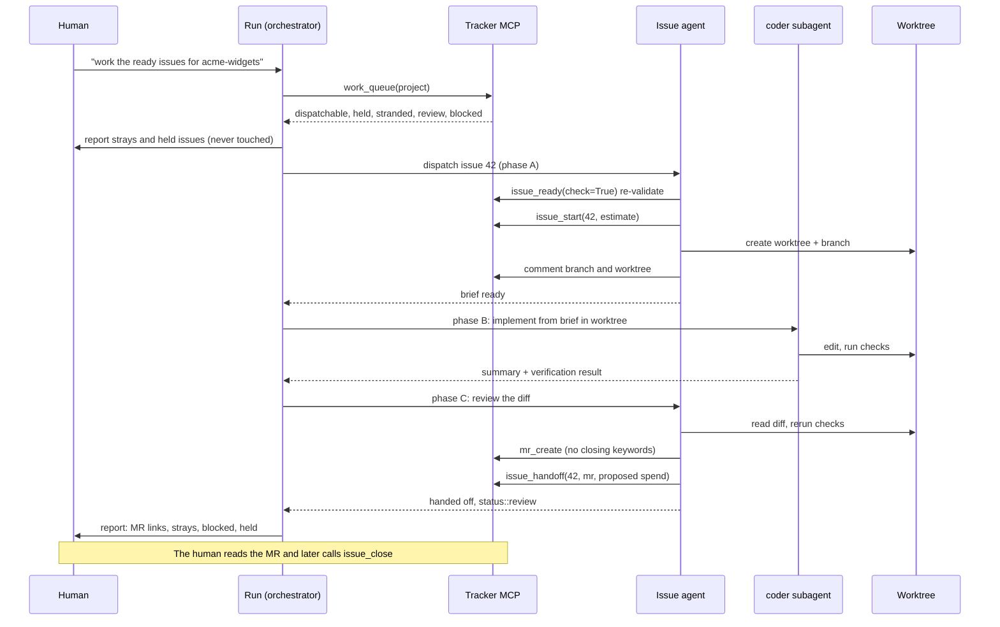

# 07. Skills: repeated workflows become one command

A skill is a markdown file (`SKILL.md`) that packages a procedure. Claude loads it when
its `description` matches the request, or when I name it. I write one when I have walked
Claude through the same multi-step procedure three times.

The test of a good skill: it states its *invariants first*, then the protocol, then what
it reports. The invariants are what survive when the model is tired and the context is
long.

Examples are in [examples/skills/](../examples/skills/).

## work-ready-issues

The agent-facing half of the review, ready, work, review loop. It dispatches one subagent
per issue sitting in `status::ready`. A human decided what was ready and a human will
decide what is done; this skill owns only the middle.

**The invariant, before anything else: agents never close an issue, never merge one, and
never approve one.** Finished work goes to `status::review` as an open merge request and
stops there. Approving looks harmless and is not. The free edition of GitLab does not
enforce approvals, so the merge tool does, which makes a human approval the only
machine-readable evidence that someone other than the author actually read the branch. An
agent approving its own work destroys the one signal the gate exists to carry.

### Two layers

The *run* reads the queue and dispatches; each *issue agent* re-validates, locks, works
and hands back inside its own subagent and returns a few lines. The run never reads an
issue body, never opens a worktree, never edits a file. That is the context argument from
[Agents](05-agents-and-model-routing.md).

At most **three issues per run**. The bottleneck is the review end: everything an agent
finishes lands as an open merge request for one human to read, and three is what one
person can review in a sitting. An explicit number from me overrides the cap.

### Three phases per issue

1. **Validate and lock** (on the session's own model). Re-run the ready check; a label
   can be flipped by hand, so `ready` is checked, not trusted. Take the dispatch lock with
   `issue_start`. Comment the branch and worktree on the issue immediately. Write an
   implementation brief.
2. **Implement** (on the mid-tier `coder`). In a dedicated git worktree, from the brief.
3. **Review** (on the session's model). Read the diff against the acceptance criteria,
   run the checks, then push, open the merge request, and `issue_handoff`.



Things the skill does that are worth stealing:

- **Strays are reported, never picked up.** An in-progress issue is either a live run or a
  dead one; nothing in the issue says which.
- **Held issues are named and not started.** Ready work that depends on an unmerged issue
  is listed with what it is waiting for. The run never waits for a merge; it reports and
  ends.
- **Underspecified means `issue_ask`.** The agent stops and moves the issue to blocked
  with written questions. Guessing is the failure the loop was built to prevent.
- **A rework round hands off onto the MR that is already open.**

## groom

The other end of the loop: `backlog -> ready`. It pre-triages a backlog against the
definition of ready, drafts acceptance criteria *from the code*, and promotes only the
issues I name in a batch reply. It never promotes on its own initiative.

Per round (10 issues):

1. Read the backlog and find the project's local checkout, or **refuse**. Drafting
   criteria from titles is the one thing grooming must not do.
2. Pre-sort with Jev over the whole backlog; read only the borderline issues, every
   disagreement with the gate, and a seeded spot-check sample.
3. Run the gate's dry run (`issue_ready(check=True)`) on every issue in the round. The
   pre-sort never replaces the gate.
4. For issues with no criteria, draft them from the code and write them append-only.
5. For issues with questions, ask the live question in the round and write the answer
   with `issue_answer`.
6. Present the round as a table and **stop**. Act only on my reply.

## work-milestone

A long, serial run over the ordering document in a milestone's description. The run is a
thin loop that reads nothing but short returns; planning a lane, working an issue,
placing a newly filed issue and delivering a lane each happen inside a subagent that
starts cold.

A **lane** is the unit of branch, merge request, delivery and merge: one branch, one MR,
one consolidated delivery per lane, force-merged before the next lane starts. A ledger
file, append-only, is the run's memory and its resume point:

```
2026-09-17T15:02  lane A start  branch lane/a  base 608d3d25
2026-09-17T15:40  #326 worked  commit 1a2b3c4d  est 3h
2026-09-17T16:10  #336 parked  2 questions asked
2026-09-17T17:05  lane A delivered  MR !150
2026-09-17T17:07  lane A merged  main 9f8e7d6c
```

It continues until nothing is left that can be done without me. Issues that need an
answer are parked with questions, not guessed at.

## ask-the-board

A panel of personas modelled on well-known engineers argues a decision from different
angles. Each gives a take in their own register, the skill maps where they agree and
where they genuinely split, then synthesizes one concrete recommendation. It is most
useful when I am clearly talking myself into something. The value is in the *adversarial*
part: a plan that nobody has pushed on is a plan that has not been tested.

## delegate

Hands a coding task, a review or a question to another vendor's agent, running headless in
a disposable worktree. Claude reviews and applies or rejects. Covered in
[Agents](05-agents-and-model-routing.md#delegate-helpers-other-vendors-agents-as-a-second-opinion).

## jev-audit

Reports closed issues that do not meet their criteria, `type::` labels that have drifted,
and commits whose diff does not match the issue they cite. Three modes, one rule:
**report only**. No comments, no label changes, no status moves. A finding is a line in the
report for me to act on. It also carries the break-even warning: below about 50 items, read
the pile instead.

## session-analysis

Mines my own session transcripts and reports. Its `dream` mode reviews past
conversations and proposes the facts, preferences, traps and standing rules worth
promoting into memory, deduplicated against what memory already holds, with a credential
screen before anything is sent anywhere. It is how traps get captured without relying on
me to remember to write them down. See [Memory](08-memory.md).

## Writing a good skill

- **Description for triggering.** List the phrases that should invoke it, and say what it
  is *not* for.
- **Invariants first.** State what the skill never does before what it does.
- **Say what it reports.** Fixed report formats keep the orchestrator's context small.
- **Name the tools it uses**, so a reader can see its whole surface.
- **Put measurements in the skill.** "At most 3 per run" with the reason beside it
  survives longer than the bare number.

Next: [08 Memory](08-memory.md)
